<!-- snippet-start -->

# Monumenten

Een Python package voor het ophalen van monumentgegevens van Nederlandse overheids-API's. Momenteel is het mogelijk om de status van rijksmonumenten, gemeentelijke monumenten, provinciale monumenten en rijksbeschermde gezichten op te halen. Eventueel in [VERA-referentiedataformaat](https://www.coraveraonline.nl/index.php/Referentiedata:EENHEIDMONUMENT).

Door middel van de package is het mogelijk om, indienst gewenst, voor tienduizenden verblijfsobjecten per seconde monumentgegevens op te halen. Er zijn geen API-keys nodig.

> [!NOTE]
> In VERA-referentiedataformaat wordt geen onderscheid gemaakt tussen rijksbeschermde stads- en dorpsgezichten. Alle rijksbeschermde gezichten worden teruggegeven als rijksbeschermd stadsgezicht.

> [!WARNING]
> Het is mogelijk dat een verblijfsobject ten onrechte wel of geen monumentstatus heeft. Dit hangt af van hoe het verblijfsobject staat geregistreerd bij het Kadaster en de Rijksdienst voor het Cultureel Erfgoed. Neem contact met hen op als u denkt u een verkeerde monumentale status terugkrijgt.

> [!NOTE]
> Een **voorbescherming** van een rijksmonument (Kadaster grondslagcode `EWD`: het ontwerpbesluit tot aanwijzing is toegezonden, maar het monument is nog niet ingeschreven in het rijksmonumentenregister) telt **niet** als rijksmonument. Artikel 8a van het Besluit huurprijzen woonruimte kent de opslag toe aan "een rijksmonument als bedoeld in artikel 1.1 van de Erfgoedwet", en dat is uitsluitend een monument dat in het rijksmonumentenregister is ingeschreven. Voorbescherming wordt daarom apart teruggegeven in de kolom `rijksmonument_voorbescherming` en heeft geen VERA-code. Voor gemeentelijke monumenten is dit onderscheid niet te maken: het Kadaster bundelt voorbescherming, aanwijzing en afschrift in één grondslagcode (`GWA`), waardoor `gemeentelijk_monument` ook voorbeschermde gemeentelijke monumenten omvat.

> [!TIP]
> Op [deze website](https://huggingface.co/spaces/woonstadrotterdam/monumenten-space) kun je via een gebruikersinterface gebruik maken van de package.

## Installatie

```bash
pip install monumenten
```

## Voorbeeldoutput

| bag_verblijfsobject_id | rijksmonument | rijksmonument_bron | rijksmonument_nummer | rijksmonument_url                                 | rijksmonument_voorbescherming | rijksbeschermd_gezicht | rijksbeschermd_gezicht_naam | gemeentelijk_monument | grondslag_gemeentelijk_monument                                                        | provinciaal_monument | provinciaal_monument_omschrijving |
| ---------------------- | ------------- | ------------------ | -------------------- | ------------------------------------------------- | ----------------------------- | ---------------------- | --------------------------- | --------------------- | -------------------------------------------------------------------------------------- | -------------------- | --------------------------------- |
| 0599010000360091       | True          | RCE, Kadaster      | 524327               | https://monumentenregister.cultureelerfgoed.nl... | False                         | False                  | <NA>                        | False                 | <NA>                                                                                   | False                | <NA>                              |
| 0599010000486642       | False         | <NA>               | <NA>                 | <NA>                                              | False                         | False                  | <NA>                        | False                 | <NA>                                                                                   | False                | <NA>                              |
| 0599010000281115       | False         | <NA>               | <NA>                 | <NA>                                              | False                         | True                   | Kralingen - Midden          | False                 | <NA>                                                                                   | False                | <NA>                              |
| 0599010000076715       | False         | <NA>               | <NA>                 | <NA>                                              | False                         | False                  | <NA>                        | True                  | Gemeentewet: Aanwijzing gemeentelijk monument (voorbescherming, aanwijzing, afschrift) | False                | <NA>                              |
| 0599010000146141       | False         | <NA>               | <NA>                 | <NA>                                              | False                         | True                   | Rotterdam - Waterproject    | True                  | Gemeentewet: Aanwijzing gemeentelijk monument (voorbescherming, aanwijzing, afschrift) | False                | <NA>                              |
| 0232010000002251       | False         | <NA>               | <NA>                 | <NA>                                              | False                         | False                  | <NA>                        | True                  | Gemeentewet: Aanwijzing gemeentelijk monument (voorbescherming, aanwijzing, afschrift) | False                | <NA>                              |
| 0599010000341377       | True          | Kadaster           | <NA>                 | <NA>                                              | False                         | False                  | <NA>                        | False                 | <NA>                                                                                   | False                | <NA>                              |
| 1680010000004810       | False         | <NA>               | <NA>                 | <NA>                                              | False                         | False                  | <NA>                        | False                 | <NA>                                                                                   | True                 | PM1-0001 Dwarshuisboerderij Rolde |

## Architectuur

De package combineert vier databronnen om monumentstatussen te bepalen:

```mermaid
flowchart TB

    %% ========================
    %% INPUT
    %% ========================
    subgraph Input["Input"]
        A["Verblijfsobject IDs<br>bijv. 0599010000360091"]
    end

    %% ========================
    %% RCE
    %% ========================
    subgraph RCE["RCE – Rijksdienst Cultureel Erfgoed"]

        subgraph RCE_RM["Rijksmonumenten Query"]
            R1["Monument"]
            R2["BasisregistratieRelatie"]
            R3["BAGRelatie"]
            R4["verblijfsobjectIdentificatie"]
            R5["rijksmonumentnummer"]
        end

        subgraph RCE_BG["Beschermde Gezichten Query"]
            G1["Gezicht"]
            G2["GezichtGeometrie"]
            G3["gezichtWKT"]
            G4["rijksbeschermd_gezicht_naam"]
        end

    end

    %% ========================
    %% KADASTER
    %% ========================
    subgraph Kadaster["Kadaster (via PDOK)"]

        subgraph BAG["BAG – Stage 1"]
            B1["Verblijfsobject"]
            B2["Adrespunt"]
        end

        subgraph BRKPB["BRK-PB – Stage 2"]
            K5["Beperking"]
            K6["grondslagCode"]
            K7["grondslagOmschrijving"]
            K8["Beperkingsgebied"]
        end

    end

    %% ========================
    %% PROVINCIES
    %% ========================
    subgraph Provincies["Provincies Noord-Holland en Drenthe"]
        V1["Monumentvlak<br>ArcGIS REST (GeoJSON)"]
        V2["categorie (NH) /<br>nummer, naam, status (DR)"]
        V3["Provinciegrens<br>PDOK Bestuurlijke Gebieden"]
    end

    %% ========================
    %% PROCESSING
    %% ========================
    subgraph Processing["Verwerking"]
        P0["Spatial join<br>adrespunt ∈ beperkingsgebied"]
        P1["Merge rijksmonumenten<br>RCE nummer + Kadaster EWE"]
        P2["Spatial join<br>adrespunt ∈ gezicht WKT"]
        P3["Filter gemeentelijke<br>grondslagcode GWA"]
        P4["Spatial join<br>adrespunt ∈ monumentvlak"]
        P5["Filter voorbescherming<br>grondslagcode EWD"]
    end

    %% ========================
    %% OUTPUT
    %% ========================
    subgraph Output["Monumentstatussen"]
        O1["Rijksmonument<br>bron: RCE en/of Kadaster"]
        O2["Beschermd Gezicht<br>bron: RCE"]
        O3["Gemeentelijk Monument<br>bron: Kadaster"]
        O4["Provinciaal Monument<br>bron: provincie"]
        O5["Voorbescherming rijksmonument<br>bron: Kadaster"]
    end

    %% ========================
    %% FLOWS
    %% ========================

    %% RCE Rijksmonumenten
    A -->|"VALUES ?identificatie"| R1
    R1 -->|"ceo:heeftJuridischeStatus"| R1
    R1 -->|"ceo:rijksmonumentnummer"| R5
    R1 -->|"ceo:heeftBasisregistratieRelatie"| R2
    R2 -->|"ceo:heeftBAGRelatie"| R3
    R3 -->|"ceo:verblijfsobjectIdentificatie"| R4

    %% RCE Beschermde Gezichten
    G1 -->|"ceo:heeftGeometrie"| G2
    G1 -->|"ceo:heeftGezichtsstatus"| G1
    G1 -->|"ceo:heeftNaam/ceo:naam"| G4
    G2 -->|"geo:asWKT"| G3

    %% Kadaster BAG
    A -->|"identificatie"| B1
    B1 -->|"geom"| B2

    %% Kadaster BRK-PB
    B2 -->|"Intersects(geom, adrespunten)"| K5
    K5 -->|"grondslagCode"| K6
    K5 -->|"grondslagOmschrijving"| K7
    K5 -->|"geom"| K8

    %% Processing
    B2 --> P0
    K6 --> P0
    K7 --> P0
    K8 --> P0
    R4 --> P1
    R5 --> P1
    P0 -->|"EWE"| P1
    P0 -->|"EWD"| P5
    B2 --> P2
    G3 --> P2
    G4 --> P2
    P0 -->|"GWA"| P3

    %% Provincies (alleen bevraagd als een adrespunt in NH of DR ligt)
    B2 --> P4
    V3 -->|"welke adressen kandidaat zijn"| P4
    V1 --> P4
    V2 -->|"filter en omschrijving"| P4

    %% Output
    P1 --> O1
    P2 --> O2
    P3 --> O3
    P4 --> O4
    P5 --> O5
```



### Bronlogica per Monumenttype

| Monumenttype                      | Primaire Bron  | Secundaire Bron | Logica                                                                                                                                                                                             |
| --------------------------------- | -------------- | --------------- | -------------------------------------------------------------------------------------------------------------------------------------------------------------------------------------------------- |
| **Rijksmonument**                 | RCE            | Kadaster (EWE)  | `rijksmonument_bron` = "RCE, Kadaster" als beide, "RCE" of "Kadaster" als één. Kadaster telt alleen als het adrespunt binnen het beperkingsgebied ligt (zie [Beperkingsgebied](#beperkingsgebied)) |
| **Rijksbeschermd Gezicht**        | RCE            | -               | Spatial join: verblijfsobject geometrie ∈ gezicht geometrie                                                                                                                                        |
| **Gemeentelijk Monument**         | Kadaster (GWA) | -               | Kadaster beperking met grondslagcode GWA, alleen als het adrespunt binnen het beperkingsgebied ligt (zie [Beperkingsgebied](#beperkingsgebied))                                                    |
| **Voorbescherming rijksmonument** | Kadaster (EWD) | -               | `rijksmonument_voorbescherming` = True; telt niet mee voor `rijksmonument` (art. 1.1 Erfgoedwet)                                                                                                   |

### Afkortingen

| Afkorting  | Betekenis                                                                                                                             |
| ---------- | ------------------------------------------------------------------------------------------------------------------------------------- |
| **BAG**    | Basisregistratie Adressen en Gebouwen: alle adressen, verblijfsobjecten en panden in Nederland                                        |
| **BGT**    | Basisregistratie Grootschalige Topografie: gedetailleerde kaart van Nederland met onder meer gebouwen, wegen, water, muren en bruggen |
| **BRK**    | Basisregistratie Kadaster: kadastrale percelen, met hun eigenaren, rechten en beperkingen                                             |
| **BRK-PB** | BRK Publiekrechtelijke Beperkingen: de beperkingen uit de BRK, zoals een monumentstatus                                               |
| **PDOK**   | Publieke Dienstverlening Op de Kaart: platform waarop de overheid geodata beschikbaar stelt                                           |
| **RCE**    | Rijksdienst voor het Cultureel Erfgoed                                                                                                |
| **VERA**   | Vastgoed Referentie Architectuur                                                                                                      |
| **WFS**    | Web Feature Service (standaard voor het opvragen van geodata)                                                                         |
| **WKT**    | Well-Known Text (geometrie formaat)                                                                                                   |

### Grondslagcodes (Kadaster)

| Code    | Wet                                                                                                  | Monumenttype                                       |
| ------- | ---------------------------------------------------------------------------------------------------- | -------------------------------------------------- |
| **EWE** | Erfgoedwet: Afschrift inschrijving rijksmonumentenregister                                           | Rijksmonument                                      |
| **EWD** | Erfgoedwet: Ontwerpbesluit aanwijzing (voorbescherming)                                              | Voorbescherming rijksmonument (geen rijksmonument) |
| **GWA** | Gemeentewet: Aanwijzing gemeentelijk monument (voorbescherming, aanwijzing en afschrift in één code) | Gemeentelijk monument                              |

De gedoogplichten voor archeologisch onderzoek (`EW` en `EWC`) zijn ook erfgoedcodes, maar geven geen monumentstatus en worden niet bevraagd.

### Beperkingsgebied

Monumentstatus staat in het Kadaster geregistreerd als een _publiekrechtelijke beperking_: een aantekening dat de overheid regels stelt aan wat je met een stuk grond of gebouw mag doen. Zo'n beperking is gekoppeld aan een _perceel_, een stuk grond met een eigen kadastraal nummer. Op één perceel kunnen meerdere gebouwen staan, en een gebouw kan op meerdere percelen staan.

Daarnaast legt de overheid die de beperking registreert (bijvoorbeeld de gemeente of de RCE) vast voor welk gebied de beperking precies geldt: het _beperkingsgebied_. Zonder extra controle zou elk adres in een gebouw dat het perceel raakt de status krijgen, ook als het monument een ander gebouw op dat perceel is, of als het gebouw maar met een strookje op het perceel staat. Daarom telt een beperking alleen als het _adrespunt_ van het verblijfsobject (de locatie van het adres in de BAG, een punt binnen het pand) binnen het beperkingsgebied ligt. De BRK-PB WFS geeft de beperkingen terug waarvan het gebied minstens één van de opgevraagde adrespunten raakt; de package bepaalt daarna zelf per adrespunt binnen welke gebieden het ligt.

Hoe nauwkeurig dat werkt, hangt af van hoe het beperkingsgebied is vastgelegd. Het Kadaster kent vier manieren (in de data het veld `typeBeperkingsgebied`):

| Type in de data                   | Het beperkingsgebied is…                                                            | Welke adressen krijgen de status                                                                                  |
| --------------------------------- | ----------------------------------------------------------------------------------- | ----------------------------------------------------------------------------------------------------------------- |
| `BAG`                             | de omtrek van één pand, overgenomen uit de BAG                                      | alleen adressen in dat pand                                                                                       |
| `Handmatig ingetekende geometrie` | een vlak dat de overheid zelf op de kaart heeft getekend                            | alleen adressen in dat vlak                                                                                       |
| `BGT`                             | één object van de BGT-kaart, bijvoorbeeld een gebouw, muur of brug                  | alleen adressen in dat object                                                                                     |
| `BRK`                             | het hele perceel (of meerdere percelen), zonder aan te geven welk gebouw bedoeld is | alle adressen waarvan het adrespunt op het perceel ligt; gebouwen op hetzelfde perceel zijn niet te onderscheiden |

Alle beperkingen van de RCE (grondslagcodes EWE en EWD) zijn met type `BRK` vastgelegd. Bij een rijksmonument met bron "Kadaster" kan het daarom zo zijn dat niet dit gebouw, maar een ander gebouw op hetzelfde perceel het eigenlijke monument is.

Er geldt geen marge rond het gebied: een adrespunt dat net buiten het gebied ligt, hoort meestal bij een buurpand. Daardoor mist de package wel een monument in een groot pand dat grotendeels in het gebied ligt, terwijl het adrespunt erbuiten valt.

### Endpoints

| Bron                | Type       | Endpoint                                                                            |
| ------------------- | ---------- | ----------------------------------------------------------------------------------- |
| **Kadaster BAG**    | WFS (PDOK) | `https://service.pdok.nl/kadaster/bag/wfs/v2_0`                                     |
| **Kadaster BRK-PB** | WFS (PDOK) | `https://service.pdok.nl/kadaster/brk-publiekrechtelijke-beperkingen-wkpb/wfs/v1_0` |
| **RCE**             | SPARQL     | `https://api.linkeddata.cultureelerfgoed.nl/datasets/rce/cho/sparql`                |

### Groeperen van verzoeken

De BRK-PB WFS doorzoekt per verzoek de omhullende rechthoek van alle opgevraagde adrespunten, en doet daar langer over naarmate die rechthoek groter is. De package houdt die rechthoek daarom klein:

1. Eerst haalt de package voor alle verblijfsobjecten het adrespunt op bij de BAG WFS, met maximaal 100 verblijfsobjecten per verzoek.
2. Daarna sorteert de package de verblijfsobjecten langs een Hilbert-curve, zodat een batch adressen bevat die bij elkaar liggen.
3. Per batch gaan maximaal 500 adrespunten in één verzoek naar de BRK-PB WFS. Is de rechthoek te groot voor het aantal adrespunten, dan splitst de package het verzoek op de grootste sprong tussen twee opeenvolgende adrespunten.

Een bezit dat in één regio ligt gaat daardoor het snelst. Adressen verspreid over heel Nederland kosten meer en tragere verzoeken.

Bij een grote aanroep toont de package een voortgangsbalk. Ernaast staat van hoeveel verblijfsobjecten de statussen tot dan toe niet volledig bepaald konden worden (`onvolledig_bepaald=…`), omdat een bron geen antwoord gaf.

De provinciale services staan hieronder bij [Provinciale monumenten](#provinciale-monumenten). De provinciegrenzen komen van PDOK Bestuurlijke Gebieden (`https://service.pdok.nl/kadaster/bestuurlijkegebieden/wfs/v1_0`, laag `Provinciegebied`, licentie CC BY 4.0).

### Retry-gedrag

Aanroepen naar Kadaster (BAG, BRK-PB) en RCE gebruiken een gedeelde retry-logica: maximaal 2 pogingen per request, bij mislukking 3 seconden wachten. Alleen tijdelijke fouten worden herhaald (HTTP 429, 500, 502, 503, 504 en netwerk-/verbindingsfouten); permanente 4xx worden direct doorgegeven. Faalt een aanroep na retries, dan wordt de set IDs/adrespunten in tweeën gedeeld en elk deel opnieuw geprobeerd (recursief, per API, tot min. 1 ID of max. splitdiepte 10). Blijft een aanroep ook dan falen, dan heeft de bron voor die verblijfsobjecten geen antwoord gegeven (zie [Als een bron geen antwoord geeft](#als-een-bron-geen-antwoord-geeft)).

Ligt een bron plat, dan stopt de package na 10 mislukte requests op rij met splitsen en slaat die bron over, met elke 10 seconden een proefrequest om te zien of zij weer antwoord geeft. Aan het einde van de aanroep krijgen de verblijfsobjecten waarvoor een bron geen antwoord gaf één herkansing bij die bron. Een korte storing kost daardoor meestal geen verblijfsobjecten.

Gaf een bron nog geen enkel antwoord, dan krijgt zij 30 seconden proefrequests voordat de aanroep stopt. Een korte hapering aan het begin van een aanroep, waarin de requests die tegelijk onderweg zijn samen falen, stopt de aanroep zo niet. Een fout die bij de request hoort en niet bij de bron (een 4xx of een afgekapt antwoord) telt pas mee als splitsen niet meer kan: één verblijfsobject dat altijd faalt, maakt dan alleen dat verblijfsobject onbepaald.

### Als een bron geen antwoord geeft

Een status die niet bepaald kon worden, is iets anders dan geen monumentstatus. De package geeft daarom nooit `False` voor een status die een bron niet heeft kunnen bevestigen of ontkennen:

- **Een bron geeft helemaal geen antwoord** (bijvoorbeeld bij een storing): de aanroep stopt met een `BronFoutError`. De melding noemt de bron (`RCE`, `BAG` of `BRK-PB`) en de laatste fout; het attribuut `verblijfsobject_ids` bevat per bron de ID's zonder antwoord.
- **Een bron geeft voor een deel van de verblijfsobjecten geen antwoord**, ook niet na de herkansing: het resultaat komt terug met `pd.NA` voor de statussen die niet bepaald konden worden, en er volgt één `MonumentStatusOnbepaaldWarning`. Die noemt per bron de laatste fout en de betrokken ID's, die ook in het attribuut `verblijfsobject_ids` staan.
- **De verwerking van een batch mislukt** (bijvoorbeeld door data die de package niet verwacht): de aanroep gaat door en de waarschuwing noemt de bron `verwerking`. Mislukken de eerste batches allemaal, dan is er iets mis met de package zelf en stopt de aanroep met de oorspronkelijke fout.

Elke status hangt af van een aantal bronnen (zie de tabel hieronder). Per verblijfsobject is een status:

- `True` als een van die bronnen het verblijfsobject de status geeft, ook als een andere bron geen antwoord gaf;
- `False` als alle bronnen antwoord gaven en geen ervan het verblijfsobject de status geeft;
- `pd.NA` als geen bron het verblijfsobject de status geeft, maar minstens één bron geen antwoord gaf.

| Status                          | Hangt af van                                     |
| ------------------------------- | ------------------------------------------------ |
| `rijksmonument`                 | RCE, BAG, BRK-PB, verwerking                     |
| `rijksmonument_voorbescherming` | BAG, BRK-PB, verwerking                          |
| `rijksbeschermd_gezicht`        | BAG                                              |
| `gemeentelijk_monument`         | BAG, BRK-PB, verwerking                          |
| `provinciaal_monument`          | BAG, provincie (alleen Noord-Holland en Drenthe) |

De BAG staat overal bij omdat zij het adrespunt levert. Een rijksmonument dat de RCE registreert, is dus `True`, ook als de BAG of de BRK-PB geen antwoord gaf.

- De statuskolommen hebben het nullable pandas-dtype `boolean`. In `process_from_list` is een niet-bepaalde status `None`; in VERA-referentiedataformaat is dan de hele value van het verblijfsobject `None` in plaats van een lijst, omdat die lijst onvolledig zou zijn.
- Blijft `rijksmonument` `True` doordat één bron de status geeft terwijl de andere geen antwoord gaf, dan noemt `rijksmonument_bron` alleen de bron die antwoord gaf.
- Een ID dat niet in de BAG van PDOK voorkomt, meestal een verblijfsobject dat nooit gebouwd is, is geen fout maar een geldig leeg antwoord. Zonder adrespunt is `rijksmonument` alleen `True` als de RCE het verblijfsobject koppelt; de andere statussen zijn `False`. De ID's staan in een `GeenAdrespuntWarning`, onder `"BAG"` in `verblijfsobject_ids`.

Wie bij gedeeltelijk falen liever een fout krijgt dan een resultaat met `pd.NA`, maakt van de waarschuwing een fout:

```python
import warnings

from monumenten import MonumentStatusOnbepaaldWarning

warnings.simplefilter("error", MonumentStatusOnbepaaldWarning)
```

### Provinciale monumenten

Naast de drie monumenttypes hierboven bepaalt de package ook de status **Provinciaal Monument** (bron: de provincie). Alleen Noord-Holland en Drenthe wijzen provinciale monumenten aan. Het Kadaster registreert ze niet (de Wkpb-grondslagcodes `MP` en `PVA` bevatten geen registraties) en de RCE evenmin. Daarom bevraagt de package de kaartservices van de provincies zelf:

| Provincie         | Service                                                                                                    | Filter                                                                                                         |
| ----------------- | ---------------------------------------------------------------------------------------------------------- | -------------------------------------------------------------------------------------------------------------- |
| **Noord-Holland** | `https://geoservices.noord-holland.nl/ags/rest/services/oi_dataservice_protected_sites/MapServer/2/query`  | Categorieën _Kleine objecten_, _Stelling van Amsterdam_, _Stelling van Den Helder_, _Waterstaatkundige werken_ |
| **Drenthe**       | `https://kaartportaal.drenthe.nl/server/rest/services/37/Provinciale_monumenten_Drenthe/MapServer/3/query` | Status `beschermd`                                                                                             |

Een verblijfsobject is een provinciaal monument als zijn adrespunt (uit de BAG) binnen een monumentvlak ligt, net als bij rijksbeschermde gezichten. `provinciaal_monument_omschrijving` bevat in Drenthe het nummer en de naam van het monument (bijvoorbeeld `PM1-0001 Dwarshuisboerderij Rolde`); in Noord-Holland alleen de categorie, omdat de provincie geen naam of nummer per vlak publiceert. Bij meerdere vlakken worden de omschrijvingen gescheiden door `, `. In VERA-referentiedataformaat is de code `PRO`.

Keuzes en beperkingen:

- **Dijken tellen niet mee.** Bij de Noord-Hollandse categorie _Keringselementen_ is de dijk zelf het monument, niet de bebouwing erop. Zonder dit filter kregen bijvoorbeeld 173 vakantiehuisjes op de Zeedijk bij Uitdam onterecht de status. Ook archeologische terreinen en het provinciaal beschermd dorpsgezicht Barsingerhorn tellen niet mee: een pand wordt geen monument doordat het in een beschermd gebied ligt. Een onbekende categorie of status wordt genegeerd met een waarschuwing in de log.
- **Alleen aangewezen monumenten.** Een voorbeschermd object (voornemen tot aanwijzing) telt niet mee, in lijn met het Besluit huurprijzen woonruimte, dat spreekt van een "door gedeputeerde staten aangewezen provinciaal monument".
- **Nauwkeurigheid.** Van de gebouwde monumenten in het Noord-Hollandse erfgoedregister (juli 2025) wordt ongeveer 91% gevonden. Gemist worden vooral objecten _bij_ een adres (een grenspaal, seinmast of hek) en een monumentaal bijgebouw op hetzelfde erf als het adres: die krijgen `False`. Andersom kan een nieuw gebouw op een monumentaal terrein (bijvoorbeeld een fort van de Stelling van Amsterdam) onterecht `True` krijgen; controleer twijfelgevallen aan de hand van de omschrijving. Een marge rond de vlakken is bewust niet toegepast: die leverde vrijwel alleen buurpanden op.
- **Geen download buiten Noord-Holland en Drenthe.** Ligt geen enkel adrespunt binnen een ruime rechthoek om Noord-Holland of Drenthe, dan volgt er geen extra request. Anders haalt de package de provinciegrenzen op bij PDOK (7 dagen gecachet). Een adres is _kandidaat_ voor een provincie als het in de rechthoek ligt én binnen de grens, met een marge van 100 m. Die marge vangt kleine verschillen tussen de datasets op: enkele Drentse monumentvlakken steken tot 1,3 m buiten de grens van PDOK. Alleen provincies met kandidaten worden gedownload (7 dagen gecachet). Zijn de grenzen niet op te halen, dan is elk adres in de rechthoek kandidaat.
- **Uitval van een provincie.** Mislukt het ophalen van een provincie na retries, of geeft haar service een onverwacht antwoord, dan gaat de rest van de aanroep gewoon door. Alleen haar kandidaten krijgen dan `<NA>` in plaats van `False`, zodat uitval van de provincie niet stilzwijgend `False` geeft:

  | Adres ligt in                               | Service werkt     | Service valt uit |
  | ------------------------------------------- | ----------------- | ---------------- |
  | een provincie zonder provinciale monumenten | `False`           | `False`          |
  | Noord-Holland of Drenthe                    | `True` of `False` | `<NA>`           |

  Bij `<NA>` noemt de `MonumentStatusOnbepaaldWarning` de provincie als bron, met haar fout als oorzaak (zie [Als een bron geen antwoord geeft](#als-een-bron-geen-antwoord-geeft)). Noemt de oorzaak dat geen enkel vlak een bekende categorie of status heeft, dan is de service van de provincie gewijzigd en moet de package worden bijgewerkt. Uitval van een provincie stopt de aanroep nooit en raakt alleen `provinciaal_monument`.

- **Combinaties.** Volgens de provinciale verordeningen kan een object niet tegelijk rijks- of gemeentelijk én provinciaal monument zijn. De package dwingt dat niet af, omdat een rijksmonument uit het Kadaster (EWE) voor het hele perceel geldt en dus ook een ander gebouw op dat perceel kan raken.

## Tutorial

<!-- snippet-end -->

Zie [readthedocs](https://monumenten.readthedocs.io/nl/latest/tutorial/).
